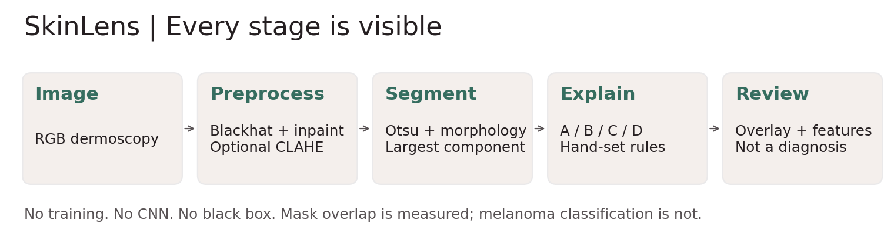
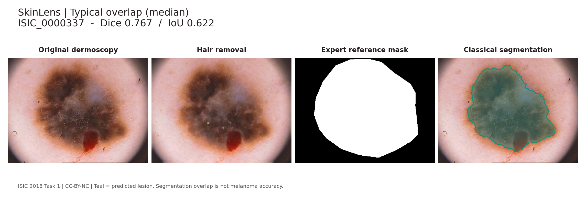
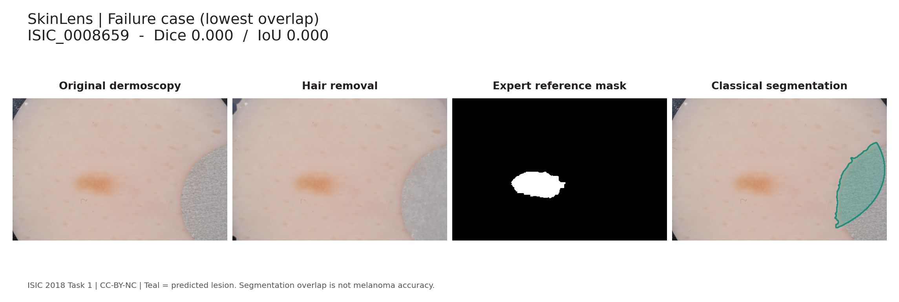
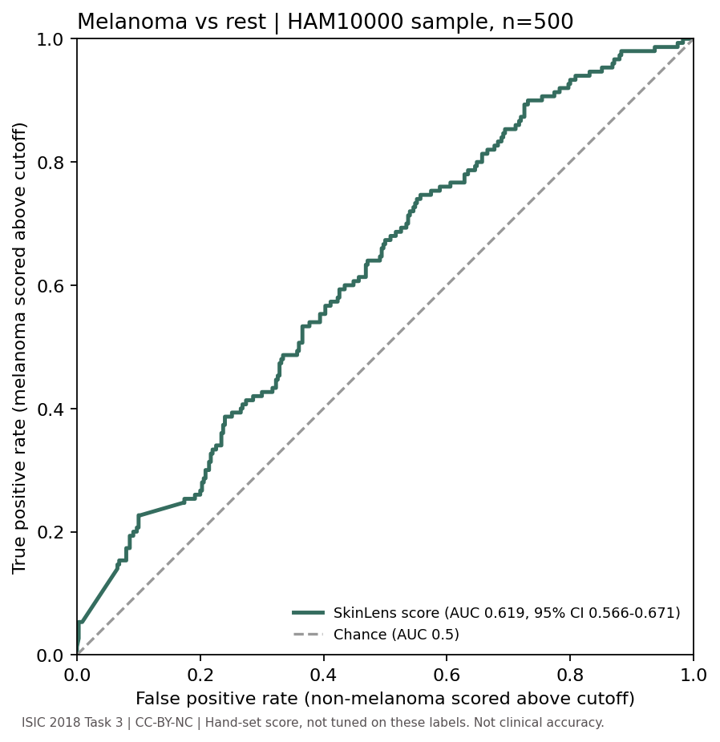

# SkinLens

**An explainable skin-lesion analysis demo built with classical digital image processing.**
For a CodeTheCure Detection & Diagnosis entry and a DIP portfolio. No CNNs, no
trained classifier, no deep learning. The project runs in Streamlit, locally or as a public demo,
shows the full processing chain, and exposes the rules behind every feature.

> Screening aid, not a diagnosis - see a dermatologist. This is an educational
> prototype, not a validated medical device. A low score does not rule out cancer.
> Do not use it to decide whether a lesion needs medical care.

## Run in one command

Python **3.10 or 3.11 recommended** (tested with Python 3.10.12 on Linux).
Internet is needed for the first dependency install, not for bundled sample analysis.

Linux/macOS, from this folder:
```bash
bash run.sh
```
Open the printed local URL (normally http://localhost:8501). Four real dermoscopy
samples are bundled (one each in the Low, Moderate and High bands, plus a deliberate
Unreliable failure-quality example), so the demo does not need the full dataset download.

Windows PowerShell:
```powershell
py -3.10 -m venv .venv
.\.venv\Scripts\python -m pip install -r requirements.txt
.\.venv\Scripts\python -m streamlit run app.py --server.address 127.0.0.1
```

If you already have an environment:
```bash
pip install -r requirements.txt
streamlit run app.py
```
On Linux, install your distribution's `python3-venv` package if venv is missing.
Top-level packages are pinned in `requirements.txt`; the tested full dependency
snapshot is in `requirements-lock.txt`. Linux was verified; Windows/macOS were not.

## What the app does

- Upload JPEG/PNG, or choose one of four bundled images.
- Display original, hair-cleaned image, and a lesion overlay.
- Show asymmetry, border compactness, color groups, and relative diameter.
- Show a transparent custom low/moderate/high **feature-based risk band**, never
  a cancer probability. Simple image-quality failures replace the band with
  **Unreliable** (the score is still computed, but the app withholds the result).
  Four bands exist: Low, Moderate, High, Unreliable.
- Download the binary mask and a JSON feature report.
- Toggle optional CLAHE and see its effect. Published default metrics use CLAHE off.
- Local runs process images on your machine. In the public hosted demo, uploads
  are sent to the hosting server. The app does not deliberately save uploads,
  but infrastructure may retain logs or temporary data. Telemetry is disabled.
  Use bundled samples online; do not upload patient, identifiable or sensitive
  images. This is not a hardened patient-data upload service.

## Pipeline



```text
RGB image (aspect-preserving, max side 512)
  -> multi-direction blackhat hair detection -> Telea inpainting
  -> optional CLAHE in Lab L channel
  -> Gaussian-smoothed Lab lightness -> Otsu threshold on valid interior
  -> opening + closing -> largest connected component -> fill holes
  -> shape + border + color + relative diameter
  -> explicit, nonclinical feature rules -> overlay + JSON report
```

Hair detection uses 17-pixel line kernels at four angles, blackhat response >18,
intensity <160, then a 3x3 dilation. Inpainting radius is 3 pixels. These hand-set
parameters are resolution-dependent and may also remove small pigmented details.
Otsu is estimated in an elliptical interior, excluding very dark pixels to reduce
vignetting. Segmentation keeps the largest region; this can select an artifact
instead of the lesion. No ground-truth mask enters the pipeline.

### Features and scoring

| Feature | Implementation | Interpretation |
|---|---|---|
| A: asymmetry | Centroid/PCA alignment, mean XOR/union against two perpendicular reflections | 0 is symmetric; approximate shape mismatch, not clinical structural asymmetry |
| B: border | Crofton perimeter squared / (4*pi*area), clamped to >=1 | 1 is circular; larger values are less compact |
| C: color | Mutually exclusive fixed RGB/HSV bins; include a bin if >=5% of segmented area | White, red, light brown, dark brown, blue-gray, black; heuristic, illumination-sensitive |
| D: diameter | Region major-axis length / longest image dimension | Relative only, **not millimeters**, excluded from the score |

Color features use hair-cleaned non-CLAHE pixels, avoiding enhancement-induced
color changes. Full color-bin inequalities are visible in `skinlens/pipeline.py`.

```python
a = clip(asymmetry / 0.45, 0, 1)
b = clip((compactness - 1) / 1.5, 0, 1)
c = clip((color_count - 1) / 4, 0, 1)
score = 100 * (0.40*a + 0.30*b + 0.30*c)
# Low <35; Moderate 35 to <65; High >=65
# Any quality-gate warning overrides the band: Unreliable
```

Weights and bands are hand-set demonstration rules, not learned or clinically
validated. Diameter is shown, but excluded because crop framing cannot estimate
physical size. **This is not TDS.** In the clinical ABCD rule of dermoscopy,
D means differential structures, not diameter. We intentionally do not reuse its
clinical cutoffs. Quality gates check selected area, edge contact and low image
contrast, but cannot reliably detect a wrong mask; inspect the overlay every time.

## Real evaluation results

| Metric | Result |
|---|---:|
| Evaluation images | 250 |
| Mean Dice | **0.661898** |
| Median Dice | 0.769580 |
| Mean IoU (Jaccard) | **0.554666** |
| Median IoU | 0.625468 |
| Mean Dice bootstrap 95% interval | 0.625687 to 0.696689 |
| Mean IoU bootstrap 95% interval | 0.519634 to 0.587839 |
| Images with IoU <0.5 | **84 / 250** |
| Quality-flagged images (band = Unreliable) | 35 / 250 (14.0%) |
| Metrics on unflagged images only (n=215) | mean Dice 0.7018, mean IoU 0.5919, 60 with IoU <0.5 |
| Metrics on flagged images only (n=35) | mean Dice 0.4168, mean IoU 0.3261, 24 with IoU <0.5 |

Protocol: deterministic shuffle (Python seed 2026) of sorted matched ISIC 2018
Task 1 **training** IDs, first 300 selected; first 50 are reserved development
images, remaining 250 are evaluation. Parameters were fixed before evaluation;
all 250 count toward the mean, including failures and flagged outputs. This is a
held-out subset of the public training release, **not** official challenge test
performance, and the split is by image, not patient. Ground-truth masks are
resized with nearest-neighbor interpolation to match max-side-512 processed
images. Metrics are macro/image-wise Dice and raw IoU, not the challenge's
thresholded Jaccard leaderboard score. Bootstrap uses 2,000 resamples of images;
patient dependence is not modeled. No cancer diagnosis labels are used.

`reports/metrics.json`, `reports/per_image.csv`, and `reports/subset_manifest.json`
contain exact results, image IDs, splits, and downloaded file SHA-256 hashes.
The pipeline source hash is recorded in metrics. Figures were selected by IoU
rank, not manual cherry-picking: 90th percentile, lower median, and minimum.




**Segmentation overlap is not melanoma detection accuracy.** The high failure rate
is part of the result, not hidden behind the demo examples. Sensitivity/specificity
at a clinical cutoff, cancer probabilities, and clinical safety were not evaluated;
the one label-based check, a melanoma-vs-rest AUC, is reported below.

### Finding: the quality gate misses most segmentation failures

The gate flags 35 of 250 images (mean IoU 0.33). But 60 of the 215 **unflagged**
images (27.9%) still have IoU <0.5. Of the 84 images with IoU <0.5, the gate catches
only **24 (28.6%)** and misses **60 (71.4%)**. In practice a missing warning does
not mean the outline is right: most bad outlines pass silently, and a shown
Low/Moderate/High band can sit on a wrong mask. Unflagged images are better on
average (mean Dice 0.702 vs 0.417), so the gate carries signal, but it is not a
safety net. Band counts on the 250 images: Low 98, Moderate 79, High 38,
Unreliable 35 (14.0%). Reproduce with `python scripts/gate_analysis.py`
(output: `reports/quality_gate.json`).

### Baselines: does the pipeline help?

Same 250 held-out images, same seed-2026 split, no tuning. Run with
`python scripts/evaluate.py --variant {otsu_gray,no_hair_removal,full}`.

| Variant | Mean Dice (95% CI) | Median Dice | Mean IoU | Median IoU | IoU <0.5 |
|---|---:|---:|---:|---:|---:|
| (a) Plain Otsu on grayscale (no blur, morphology or component selection) | 0.530 (0.495 to 0.563) | 0.583 | 0.406 | 0.412 | 154 / 250 |
| (b) Full pipeline minus hair removal | 0.658 (0.621 to 0.696) | 0.755 | 0.553 | 0.606 | 88 / 250 |
| (c) Full pipeline | 0.662 (0.626 to 0.697) | 0.770 | 0.555 | 0.625 | 84 / 250 |

The pipeline beats plain Otsu by a large margin (+0.132 mean Dice). Hair removal
does **not** show a measurable benefit here: the paired mean Dice difference
(c minus b) is +0.004 (bootstrap 95% interval -0.013 to +0.021), it improves 85
images and worsens 125. The gain over plain Otsu comes from the smoothing,
morphology, interior-restricted threshold and largest-component steps, not from
inpainting. Hair removal is kept because it is part of the specified pipeline and
may matter on heavily haired images; this evaluation cannot show that. Baseline
outputs are in `reports/baselines/`. (The plain-Otsu quality-flag count is
meaningless as a gate result because its unfiltered masks nearly always touch the
image edge.)

### Score validation: melanoma vs rest (ISIC 2018 Task 3 / HAM10000)

The ABCD-inspired score is hand-set and was never tuned on diagnosis labels. To
test whether it ranks melanoma above other lesions, `scripts/validate_score.py`
runs the unchanged `analyze()` pipeline on 500 HAM10000 training images (150
melanoma, 350 other classes, seed 2026; melanoma is enriched versus the ~11% in
the dataset, which does not change AUC in expectation) and compares the continuous
score to the Task 3 ground-truth labels.

| Result | Value |
|---|---:|
| Images (melanoma / other) | 500 (150 / 350) |
| **ROC-AUC, score vs melanoma** | **0.619** (bootstrap 95% CI 0.566 to 0.671) |
| AUC, unflagged images only (n=453) | 0.630 (0.575 to 0.682) |
| Chance | 0.500 |
| Component AUC: asymmetry / border / color | 0.582 / 0.535 / 0.695 |



Reading it honestly: hand-set rules reach AUC 0.62 against 0.5 for chance. That is
a real but weak signal, far from clinical usefulness. The color-count component
alone (0.695) ranks better than the combined score, so the hand-set weights are
not optimal. Bootstrap: 2,000 stratified resamples. Bands (counts of
melanoma / total): Low 46/208, Moderate 55/156, High 38/89, Unreliable 11/47.
**This validates the score only as a melanoma-vs-rest discriminator on this
dermoscopy sample. It is not clinical accuracy:** there is no sensitivity or
specificity at a clinical cutoff, no patient-level split (HAM10000 has repeated
lesions per patient), no skin-tone breakdown, and no external dataset. Outputs:
`reports/validation/score_validation.{json,csv}` and `roc_melanoma.png`.

## Reproduce in one command

```bash
bash reproduce.sh
```
This installs packages, downloads 300 image/mask pairs, runs tests, and rebuilds
all evaluation reports. Or run steps yourself:
```bash
python scripts/download_data.py --count 300 --seed 2026
python -m pytest -q
python scripts/evaluate.py
# Optional development-only comparison; keep output separate:
python scripts/evaluate.py --split development --output reports/development
# Baselines, quality-gate analysis and melanoma-vs-rest score validation:
python scripts/evaluate.py --variant otsu_gray
python scripts/evaluate.py --variant no_hair_removal
python scripts/gate_analysis.py
python scripts/validate_score.py   # downloads 500 Task 3 images via HTTP Range
```

The downloader reads official ZIP central directories with HTTP Range requests,
then downloads selected members, avoiding the multi-GB image archive. It uses
six workers, retries transient failures, resumes existing files, and records a
manifest. A proxy/server that strips Range support may make remote ZIP access
fail; rerun on a network that supports HTTPS byte ranges. Evaluation refuses
checksum or image/mask dimension mismatches. `data/` is gitignored and is not in
the handover archive. Download duration depends on network and server conditions.

## Limits and responsible use

- Intended input is **dermoscopic imagery**, not arbitrary phone photographs.
- It cannot distinguish benign lesions from melanoma. Nonpigmented lesions,
  low contrast, shadows, rulers, hairs, bubbles and vignetting cause failures.
- The data do not establish performance across skin tones or demographic groups.
  There is no demographic fairness audit or prospective clinical validation.
- No scale calibration or longitudinal evolution measurement. A small or uniform
  lesion can still be melanoma. No score should reassure someone to delay care.
- Color categories are simple pixel rules, not a dermatologist's assessment.
- The quality gate catches only 24 of the 84 segmentation failures (28.6%); 60 of
  215 unflagged images still have IoU <0.5. A band without the Unreliable label is
  not evidence of a correct outline.
- The score's melanoma-vs-rest AUC is only 0.62 (95% CI 0.57 to 0.67) on a
  HAM10000 sample; it is weak evidence, not a diagnostic tool.
- Thresholds and quality checks can fail silently. Human visual review of the
  segmentation is required even if the band is shown.
- Do not deploy publicly or collect patient information without appropriate
  privacy/security controls and clinical/regulatory review.
- Code is MIT. Dataset samples and image-derived figures are **CC-BY-NC**, not MIT.
  See `DATA_LICENSE.md`. Check these terms before commercial use or publication.

## Repository map

```text
app.py                     Streamlit application
skinlens/pipeline.py       Complete classical algorithm and transparent rules
scripts/download_data.py   Matched-pair subset downloader + checksums
scripts/evaluate.py        Dice/IoU, CSV/JSON and figures; --variant for baselines
scripts/gate_analysis.py   Quality-gate catch/miss analysis
scripts/validate_score.py  Melanoma-vs-rest AUC on ISIC 2018 Task 3 labels
samples/                   Four downsampled development images (Low/Moderate/High/Unreliable) + credits
reports/                   Real evaluation outputs, diagram and examples
reports/baselines/         Otsu and no-hair-removal ablations
reports/validation/        Score AUC results, per-image CSV, ROC curve
tests/                     Synthetic pipeline checks + Streamlit sample/CLAHE tests
requirements.txt           Pinned direct dependencies
requirements-lock.txt      Tested complete dependency snapshot
run.sh / reproduce.sh      One-command launch / reproduction
DATA_LICENSE.md / LICENSE  Dataset attribution / MIT code license
DEMO.md                    Three-minute walkthrough and honest pitch
```

## Sources

- ISIC 2018 Task 3 (HAM10000) labels used for score validation: https://challenge.isic-archive.com/data/
- ISIC data and attribution: https://challenge.isic-archive.com/data/
- ISIC Task 1 mask definition/provenance: https://challenge.isic-archive.com/landing/2018/45/
- Official archive mirror attribution: https://figshare.com/articles/dataset/ISIC2018_Task1-2_Training_Input_zip/22698379
- Clinical dermoscopy ABCD (D = structures): https://dermnetnz.org/cme/dermoscopy-course/other-algorithms-for-melanocytic-lesions
- ABCDE limitations: https://dermnetnz.org/topics/abcdes-of-melanoma

The repository and public demo are published separately from the local handover.
The public demo is for sample-based educational use, not patient screening.
